# SECOM Wafer Yield Analysis: Root Cause and SPC

Root-cause analysis and statistical process control on 1,567 production wafers and 590 in-line sensors from a real semiconductor fab (UCI SECOM). A single sensor, **s59**, explains most of the early-period failures, and that process regime later changed underneath the model.

---

## Key Findings

- **One sensor dominates.** In the XGBoost model, s59 has a mean |SHAP| of **0.878**. That is more than 3× the next sensor (s460, 0.265). On training wafers, failing wafers had a median s59 of **10.437** vs **1.439** for passing wafers (Mann-Whitney p < 0.0001).
- **The process changed on about Sept 1, 2008.** s59's standard deviation fell from **13.03** before Sept 1 to **3.95** after. Over the same split, fail rate fell from **10.5%** to **4.1%**.
- **SPC would have caught the excursion.** Run retroactively with limits from the stable period, the s59 I-MR chart flagged **42%** of pre-Sept 1 wafers as out of control. Those wafers failed at **16.2%** vs **6.4%** for in-control wafers.
- **Static models degrade under drift.** XGBoost scored a PR AUC of **0.117** in time-series cross-validation on the training period but only **0.078** on later test wafers, where random is 0.055.
- **Takeaway for the fab:** the early excursion was an s59 problem. In the later monitoring window, the s59 chart flagged 7 wafers, and none of them failed. The remaining fails come from something else, which argues for continuous SPC with maintained control limits over a one-time predictive model.

---

## Background

Yield is the main economic lever in a fab. Each scrapped wafer carries the cost of every process step before it, and a drifting tool can affect hundreds of wafers before end-of-line test catches it. Process and module engineers rely on two things to limit that exposure. The first is root-cause analysis, to find which parameter is driving fails. The second is statistical process control (SPC), to detect when a parameter leaves its stable state, ideally before it costs yield. This project applies both to real, anonymized fab sensor data.

## Dataset

| | |
|---|---|
| Source | [UCI ML Repository: SECOM (dataset 179)](https://archive.ics.uci.edu/dataset/179/secom) |
| Wafers | 1,567 |
| Sensors | 590 (anonymized; named `s0`–`s589` here) |
| Fails | 104 (6.6%). Always predicting "pass" would score 93.4% accuracy, so accuracy is not a useful metric. |
| Time span | 2008-07-19 to 2008-10-17 |
| Missing data | 4.5% of all values; 538 sensors have some missing data; 28 are >50% missing |
| Constant sensors | 116 (a single unique value across all wafers) |

<details>
<summary>Data quality figures</summary>

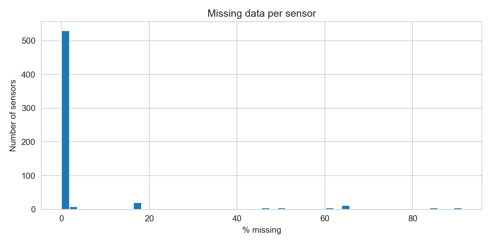
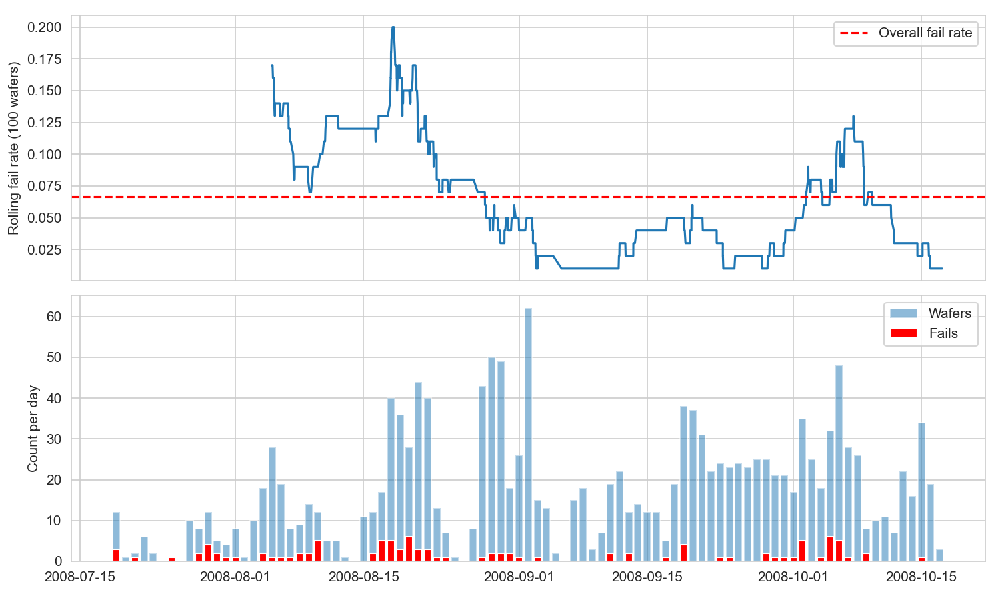

</details>

---

## Approach

### 01: Exploratory data analysis
This notebook profiles class balance, missingness, constant sensors and value ranges. Sensor standard deviations span 0.0001 to 6,554, so scaling is required for linear models. It also tracks the rolling fail rate over time and confirms wafers are already in chronological order.

### 02: Preprocessing (`02_preprocessing.ipynb`)
The data is split **chronologically** into 70/30 train/test, so the model always predicts *future* wafers, as it would in production. Every filtering and imputation statistic is **fit on training data only** and then applied to test data, to avoid leakage.

| Step | Sensors |
|---|---|
| Raw | 590 |
| Drop >50% missing (train) | −24 |
| Drop constant (train) | −122 |
| After filtering | 444 |
| Median imputation (train medians) | — |
| Clip to train 0.5%–99.5% quantiles | — |
| Drop one of each pair with \|r\| > 0.95 | −168 |
| **Final** | **276** |

| Split | Wafers | Fails | Fail rate |
|---|---|---|---|
| Train (to 2008-09-26) | 1,096 | 78 | 7.1% |
| Test (from 2008-09-26 03:12) | 471 | 26 | 5.5% |

### 03: Modeling
The baseline is logistic regression (standardized inputs, `class_weight="balanced"`, C = 0.1). It is compared with XGBoost (depth 3, 300 trees, `scale_pos_weight` = 13.1 to offset the class imbalance). The decision threshold is chosen by maximizing **F2**, which weights catching fails above avoiding false alarms. F2 is computed on out-of-fold predictions from 5-fold `TimeSeriesSplit` cross-validation on the **training set only**. The test set is used once, for final evaluation.

### 04: Root cause
SHAP (TreeExplainer) is run on the trained XGBoost model to rank sensors by contribution. For the top 6 sensors, Mann-Whitney U tests compare pass vs fail distributions, and a time-series view of the top sensors checks for regime changes.

### 05: SPC
A 50-wafer rolling standard deviation of s59 locates the regime change. I-MR charts are then built for the top 5 SHAP sensors:

- **Phase I (setting limits):** passing training wafers from **after Sept 1** only (462 wafers for s59). σ is estimated as MR̄ / 1.128, and the MR chart UCL is 3.267 × MR̄. Limits computed on a window that included the unstable regime came out too wide, so they were reset to the stable period. This is the standard Phase I lesson: limits must come from a process that is actually in control.
- **Phase II (monitoring):** the 471 test wafers from 2008-09-26 onward.
- **Western Electric rules:** (1) 1 point beyond 3σ; (2) 2 of 3 beyond 2σ on the same side; (3) 4 of 5 beyond 1σ on the same side; (4) 8 in a row on one side of the centerline.

Cpk is computed against **assumed** spec limits (see Results and Limitations).

---

## Results

### Model performance (test set: 471 wafers, 26 fails)

| Model | CV PR AUC (train) | Test PR AUC | Test ROC AUC | Fails caught | False alarms |
|---|---|---|---|---|---|
| Random baseline | — | 0.055 | 0.5 | — | — |
| Logistic regression | 0.076 | 0.077 | 0.608 | 4 / 26 (15.4%) | 61 / 445 |
| XGBoost | 0.117 | 0.078 | 0.630 | 8 / 26 (30.8%) | 135 / 445 |

**Engineering read:** both models do only slightly better than random on future wafers. XGBoost's drop from 0.117 in cross-validation to 0.078 on test is consistent with the process changing between the two periods, not just with overfitting. Under logistic regression, some test wafers sit up to 12 standard deviations from the training mean (s114, s151). That is further evidence the test period is out of distribution.

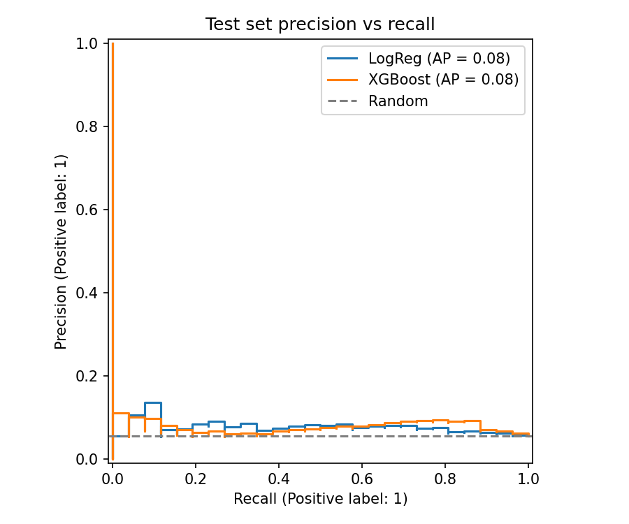

### Root-cause sensors (training wafers)

| Sensor | Mean \|SHAP\| | Pass median | Fail median | Mann-Whitney p | Significant after Bonferroni (α = 0.05/6)? |
|---|---|---|---|---|---|
| **s59** | **0.878** | **1.439** | **10.437** | **< 0.0001** | **Yes** |
| s460 | 0.265 | 26.163 | 29.432 | 0.0035 | Yes |
| s205 | 0.244 | 8.080 | 10.110 | < 0.0001 | Yes |
| s587 | 0.209 | 0.015 | 0.018 | 0.0151 | No |
| s102 | 0.179 | 0.000 | −0.008 | 0.0260 | No |
| s488 | 0.173 | 356.938 | 316.957 | 0.0357 | No |

High s59 values push predictions toward "fail": s59's value correlates with its SHAP contribution at r = 0.77. After Bonferroni correction, only s59, s460 and s205 remain significant.

<p float="left">
  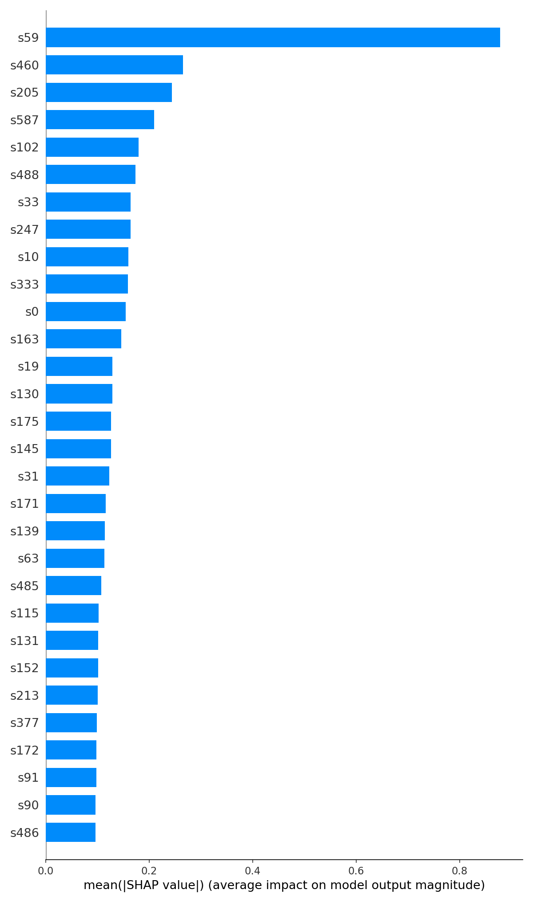
  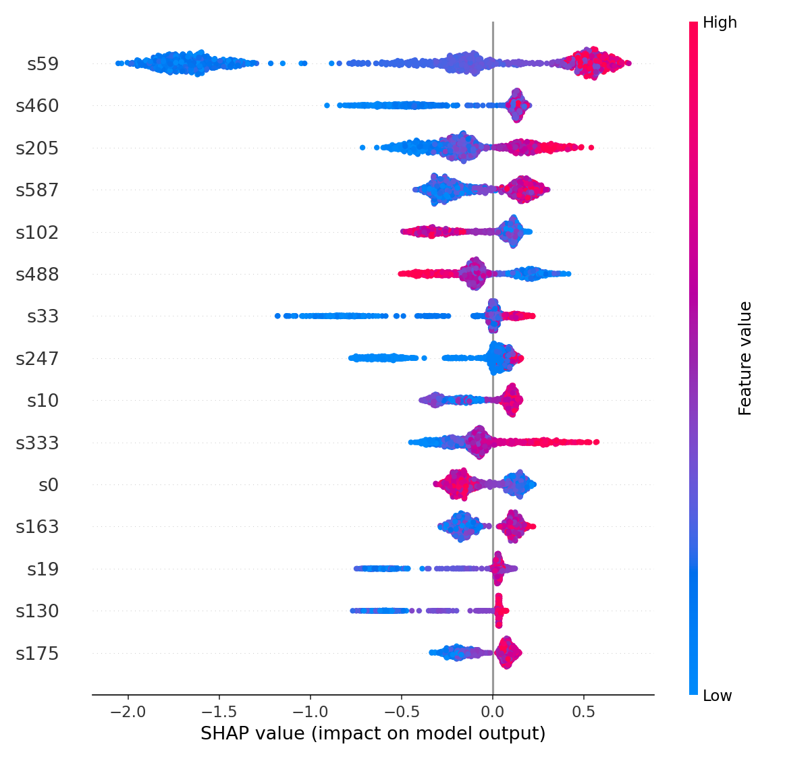
</p>

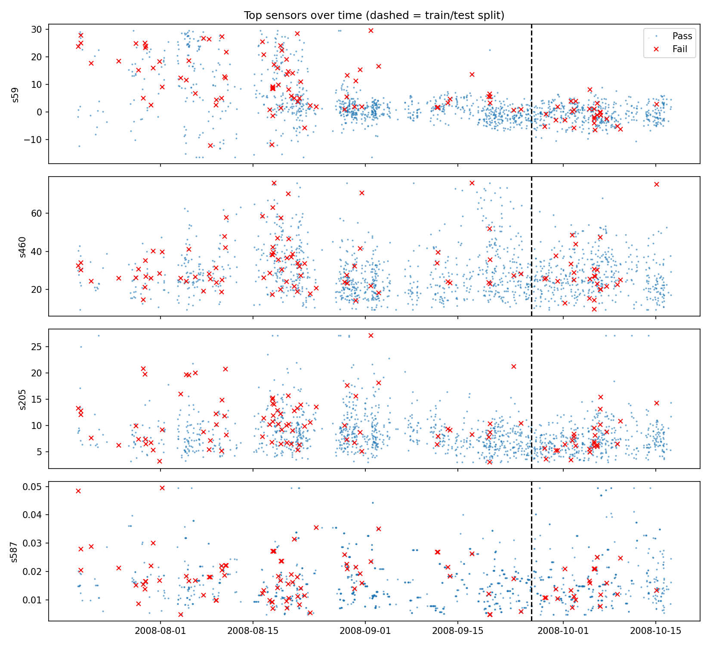
*Fails (red) cluster at high s59 values in late July to August. After that, s59's spread collapses and fails no longer separate on it.*

### Regime change in s59

[VERIFY: rolling-std figure. The plot in `05_spc.ipynb` is shown but never saved; save it as `figures/s59_rolling_std.png` and embed it here]

| Period | s59 std | Fail rate |
|---|---|---|
| Before Sept 1, 2008 | 13.03 | 10.5% |
| After Sept 1, 2008 | 3.95 | 4.1% |

### SPC: s59 I-MR chart

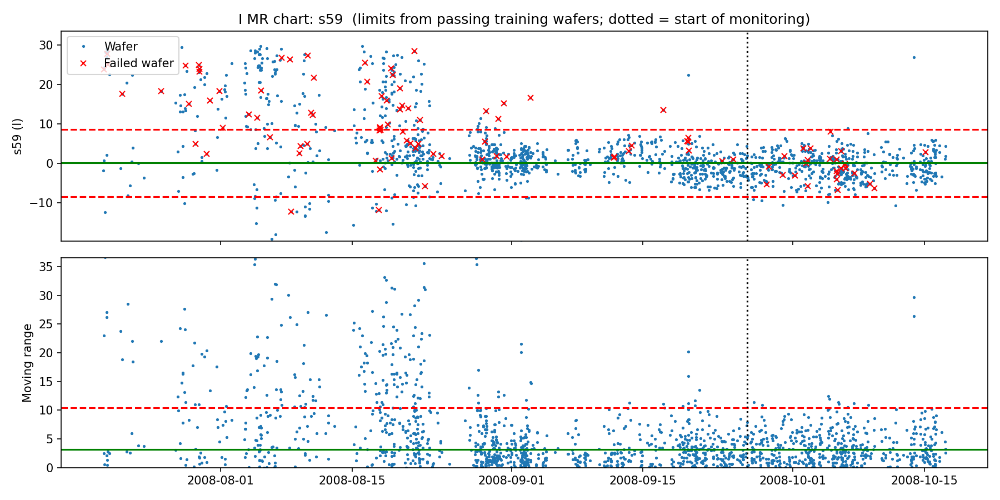

s59 limits: center 0.16, UCL 8.68, LCL −8.35; MR̄ 3.20, MR UCL 10.46.

**Retroactive check (WE Rule 1, s59 limits):**

| Period | Wafers out of control | Fail rate when out of control | Fail rate when in control |
|---|---|---|---|
| Before Sept 1 | 42% | 16.2% | 6.4% |
| After Sept 1 | 1% | 21.4% | 3.9% |

Before the change, an out-of-control s59 reading went with about 2.5× the fail rate. After the change, s59 rarely leaves its limits at all.

**Phase II monitoring (test window: 471 wafers, 26 fails, baseline fail rate 5.5%):**

| Sensor | Rule 1 flags | Fail rate when Rule 1 flagged | Any-rule flags | Fail rate when any rule flagged |
|---|---|---|---|---|
| s59 | 7 | 0.0% | 48 | 8.3% |
| s460 | 2 | 50.0% | 18 | 11.1% |
| s205 | 5 | 0.0% | 46 | 2.2% |
| s587 | 151 | 4.0% | 353 | 5.7% |
| s102 | 6 | 16.7% | 45 | 6.7% |

| Detector (test window) | Wafers flagged | Fails caught | False alarms |
|---|---|---|---|
| s59 chart alone (Rule 1) | 7 | 0 / 26 | 7 |
| Any of the top-5 charts (Rule 1) | 164 | 7 / 26 | 157 |
| XGBoost (notebook 03) | 143 | 8 / 26 | 135 |

**Engineering read:** in the monitoring window, the s59 chart is quiet and catches none of the 26 fails. The excursion that drove the early fails is over, and the remaining fails are not an s59 signature. s587 flags 151 wafers under Rule 1 alone, which points to a skewed or non-normal sensor that I-MR limits don't suit (see Future Work).

<details>
<summary>Other I-MR charts</summary>

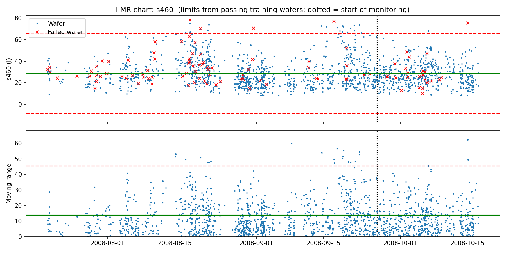
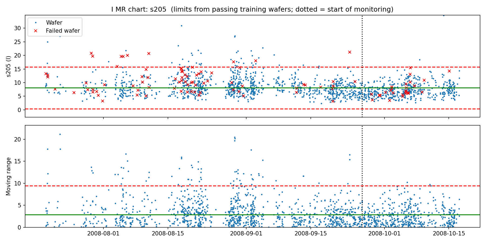
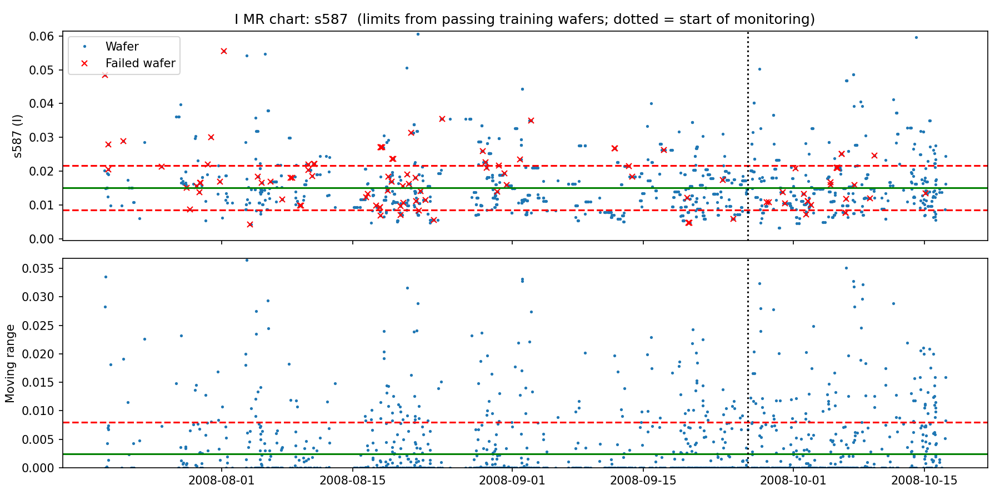
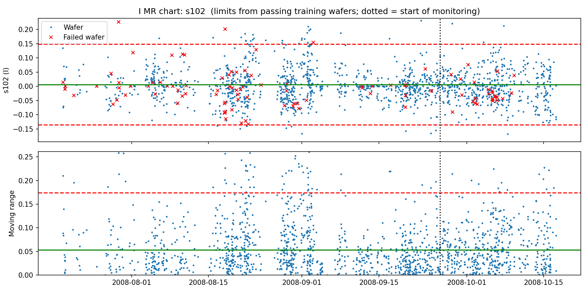

</details>

### Process capability (assumed specs)

> ⚠️ SECOM does not publish spec limits. Specs here are **assumed** as the baseline mean ± 4σ, so every sensor has a baseline Cpk of 1.33 by construction. The test-window Cpk shows how much capability was lost relative to the stable period, not the real capability against real specs.

| Sensor | Baseline Cpk (by construction) | Test-window Cpk | Test mean shift (σ) |
|---|---|---|---|
| s59 | 1.33 | 1.17 | −0.24 |
| s460 | 1.33 | 1.82 | −0.06 |
| s205 | 1.33 | 0.51 | −0.06 |
| s587 | 1.33 | 0.90 | 0.26 |
| s102 | 1.33 | 1.33 | −0.14 |

s205's mean barely moves (−0.06σ), yet its Cpk drops to 0.51. The capability loss comes from increased spread, not a mean shift.

---

## Sample OCAP: s59

*Out-of-Control Action Plan for the s59 I-MR chart (limits: I chart 8.68 / 0.16 / −8.35, MR UCL 10.46).*

| Trigger | Action | Owner |
|---|---|---|
| 1 point beyond the 3σ limit (WE Rule 1) | Hold the lot. Verify the measurement (re-measure or check the gauge). If confirmed, inspect the tool associated with s59. | Technician, then process engineer |
| 2 of 3 beyond 2σ, or 4 of 5 beyond 1σ (WE Rules 2–3) | Flag the tool. Increase sampling. Review recent PMs, recipe changes and consumables. | Process engineer |
| 8 in a row on one side of the centerline (WE Rule 4) | Investigate a mean shift. Compare against the last known-good state. Consider recalibration. | Process engineer |
| MR beyond its UCL | Investigate the variability increase, the failure signature of the pre-Sept 1 regime (s59 std 13.03 vs 3.95). | Module engineer |
| Any confirmed excursion | Disposition the affected wafers. Release the tool only after qualification wafers run in control. Document root cause and update the limits if the process has changed. | Module engineer |

---

## Limitations

- **Anonymized sensors.** Without sensor names or tool context, findings cannot be linked to a physical mechanism. "s59" could be a chamber pressure, a temperature or a metrology reading.
- **Assumed spec limits.** The specs are the baseline mean ± 4σ, not real LSL/USL values. Cpk values also assume normality, which several sensors clearly violate (for example, s587).
- **Overlapping windows.** The Phase I baseline (Sept 1 to Sept 26 passing wafers) falls inside the "After Sept 1" period of the retroactive check. The post-change rate of 1% out of control is partly in-sample.
- **Small fail counts.** The test set has only 26 fails, so one extra catch moves recall by about 4 points. All test metrics carry wide uncertainty.
- **SPC limit bias.** The I-MR limits were built from passing wafers in the training window. Excluding fails narrows the limits, which inflates the out-of-control rate in the evaluation window. Fail-rate differences between flagged and unflagged wafers may therefore be overstated.
- **Selection then testing.** The Mann-Whitney sensors were chosen by SHAP on the same training data, so the p-values are optimistic even after Bonferroni correction.
- **Root cause reflects the early regime.** The training set is mostly pre-change wafers, so SHAP rankings describe the s59 excursion. They don't describe what drives the remaining post-change fails.

## Future Work

- Root-cause analysis on **post-change wafers only**, to find what drives the remaining fails.
- **Log transforms** for heavily skewed sensors before charting and modeling.
- **Multivariate SPC** (Hotelling T², MEWMA) to catch correlated shifts that univariate charts miss.
- Rolling or periodically retrained models, with drift detection on the input distributions.
- Formal Phase I limit setting, with iterative removal of out-of-control points.

---

## How to Run

```bash
git clone <repo-url> && cd secom-yield-analysis
python3 -m venv .venv && source .venv/bin/activate
pip install -r requirements.txt
```

Download `secom.data` and `secom_labels.data` from the [UCI SECOM page](https://archive.ics.uci.edu/dataset/179/secom) into `data/`. The `data/` folder is git-ignored. Then run the notebooks in order:

1. `notebooks/01_eda.ipynb`
2. `notebooks/02_preprocessing.ipynb`: writes `data/processed/train.csv` and `test.csv`
3. `notebooks/03_modeling.ipynb`: writes `data/processed/xgb.joblib`
4. `notebooks/04_root_cause.ipynb`: needs the saved model from step 3
5. `notebooks/05_spc.ipynb`

Figures are written to `figures/`.

## Tools

Python · pandas · NumPy · scikit-learn · XGBoost · SHAP · SciPy · matplotlib · seaborn
